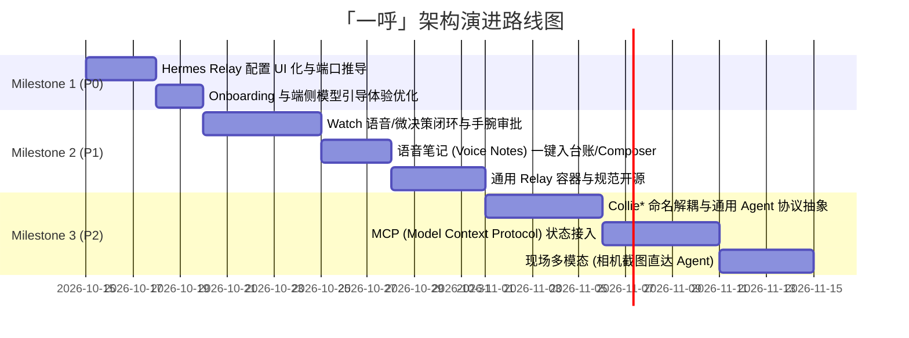

# 「一呼」(Yihu) 架构演进与产品路线规划方案 (Plan)

> **分支**：`feat/architecture-evolution`  
> **定位**：从单一 Collie 伴侣平滑演进为面向未来的「多 Agent 移动与可穿戴式指挥中枢」  
> **核心原则**：保持 Swift 6 / iOS 18+ 原生底座与端侧零知识安全规范，拒绝无谓重构，实施模块化演进。

---

## 阶段规划概览

---

## Milestone 1 (P0): 打通最后一公里 · 开箱即用 (Quick Win)

### 任务 1.1：Hermes Relay 配置动态化与智能推导
- **现状分析**：
  - `CollieHermesPush.relay` 目前为静态常量 `URL(string: "https://relay.example.invalid")!`。
  - 需要在编译期或源码内修改才能连接用户自己的中继。
- **实施方案**：
  1. 在 `CollieHermesPush` 中增加持久化配置存储（`UserDefaults` / App Group），支持动态 Relay URL：
     - 若未手动设置，且当前工作台 Origin 端口为 `9444`，默认推导为 `https://<origin.host>:9444`。
     - 提供合法性校验与重置机制。
  2. 在 `CollieLinkSettingsView.swift` 中的 `CollieHermesPushSection` 增加：
     - Relay 地址输入框与当前连接状态指示器（检测 Tailscale 连通性）。
     - 一键从当前工作台同步地址按钮。
- **验收标准**：
  - 用户无需重编代码，在设置界面输入自己的 Relay 地址即可成功开启 APNs 与 Push-to-Start 实时活动。

### 任务 1.2：首次启动与端侧模型引导体验优化 (Onboarding)
- **现状分析**：
  - Qwen3 ASR 与 CAM++ 声纹模型需用户主动在设置中下载与录制，新用户缺乏引导，容易忽略其安全价值。
- **实施方案**：
  1. 设计首屏/首次开启语音时的轻量引导卡片（Value Proposition Sheet）：
     - 强调“100% 离线识别，代码与机密不出设备”；
     - 强调“专属声纹风控，杜绝环境杂音意外向 Agent 注入指令”。
  2. 优化断点续传与失败恢复文案，在模型未准备就绪时给出清晰的前进指引。
- **验收标准**：
  - 首次启动体验清晰流畅，引导用户顺利完成模型下载与声纹录制。

---

## Milestone 2 (P1): 放大核心价值 · 打造杀手级微交互 (High Leverage)

### 任务 2.1：Apple Watch 手腕语音与微决策闭环
- **现状分析**：
  - 工作区已有正在开发的 `YihuWatchVoiceCapture.swift` 与 `Shared/YihuWatchVoice.swift`。
  - 当前手表的提案仅支持发回手机由用户人工核对写入。
- **实施方案**：
  1. 完成 Watch 端高品质录音经由 `WatchConnectivity` 传递到手机，由手机端 Qwen3 进行本地 ASR 转写并回传结果。
  2. 针对 PM Radar / 任务流中的“等你决策”和“等你验收”条目：
     - 在保持 `sourceToken` 与 `taskToken` 严密校验的前提下，支持可信的“手腕微审批”（直接提交“确认”或“重试”）。
     - 限制在低风险操作（非危险代码提交或删除），解挂桌面等待。
- **验收标准**：
  - 手腕上既能录入手腕提案，又能在 2 秒内完成高频微审批。

### 2.2：全天候语音笔记 (Voice Notes) 直达工作台
- **现状分析**：
  - `CollieVoiceNotesStore` 具备锁屏录音、自动分段与端侧识别能力，但产出的文本仅保存在本地备忘列表中。
- **实施方案**：
  1. 在 `CollieVoiceNotesView` 中增加操作：
     - **“发送至当前工作台”**：调用 `CollieTextInsertion` 自动注入当前打开的 Collie/Hermes Composer。
     - **“转为需求/待办”**：生成格式化标题与描述，直接接入本地需求台账。
- **验收标准**：
  - 灵感或 Bug 录音转写后，一键直接变成 Agent 的输入。

### 2.3：开源独立 Hermes Relay 容器与规范
- **实施方案**：
  1. 提供独立、轻量的 Dockerfile 与 Python 服务脚本（基于 `tools/serve-radar.py` 与 `radar_notifications.py` 的设计）。
  2. 包含 Tailscale 接入说明、APNs 配置与 Push-to-Start 代理逻辑，使开发者能 5 分钟在自己的 VPS/内网 NAS 上拉起中继。

---

## Milestone 3 (P2): 平台化解耦 · 通用 Agent 移动基座 (Universal Platform)

### 任务 3.1：命名与模块抽象解耦
- **实施方案**：
  - 将 `Apps/Collie/` 下与特定产品绑定的类与协议平滑重命名/别名化：
    - `CollieWebSession` $\to$ `AgentWebSession`
    - `HermesTaskAttributes` $\to$ `AgentTaskAttributes`
    - `CollieShareTrayModel` $\to$ `AgentShareTray`
  - 建立统一的 `AgentProtocol` 插件式结构。

### 任务 3.2：支持标准 MCP (Model Context Protocol) 与通用 Webhook
- **实施方案**：
  - 定义统一的 Agent 任务状态上报 JSON 格式（阶段、工具名称、进度、耗时）。
  - 提供标准的 MCP Tool 或 Webhook，让 Claude Code、OpenHands、Cursor 等第三方智能体也能直接联动一呼的灵动岛与实时活动。

### 任务 3.3：现场多模态上下文快速接入 (Camera / Screen Diagnostics)
- **实施方案**：
  - 扩展 `CollieShareTray`，在 App 内置快速拍照与相册选择入口；
  - 针对开发者拍摄外接显示器报错、手绘架构草图场景，图片就地轻量压缩并自动挂载至 Agent 任务附件。

---

## 验证与发布标准

1. **测试基线**：
   - 保持现有的 `swiftc -swift-version 6` 模型与持久化无警告编译；
   - 运行并通过 `CollieUITests` 与 `Tests/CollieRadar/ModelChecks.swift`。
2. **规范约束**：
   - 绝不降低安全边界：离线 ASR、声纹风控、Tailscale 身份认证和防自动发送 DOM 守卫必须完整保留。
